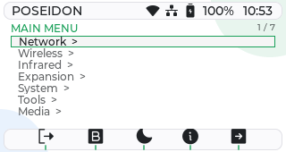

<p align="center">
  <picture>
    <source
      media="(prefers-color-scheme: dark)"
      srcset="./screenshot/poseidon-zero-dark-320x170.png"
    />
    <source
      media="(prefers-color-scheme: light)"
      srcset="./screenshot/poseidon-zero-light-320x170.png"
    />
  
  </picture>
</p>

<div align="center">
    <h1>POSEIDON-Zero</h1>
</div>

<div align="center">
  <p>A keyboard-friendly system and utility dashboard for the Linux-based CardputerZero.</p>
</div>

<p align="center" style="margin: 20px 0; display: flex; justify-content: center; flex-wrap: wrap; gap: 12px;">
  
  
  
  
</p>

<p align="center">
  <a href="https://discord.gg/ysQAWBUE9Q">
    
  </a>
</p>
POSEIDON-Zero brings a themed, keyboard-first interface and practical local utilities to the
CardputerZero. Desktop builds use an SDL simulator for UI preview; device builds use Linux and
LVGL platform drivers. Features without a supported implementation are marked `[OFF]`.

## Project Overview

The app uses a small MVVM-style structure around LVGL:

- **UI layer**: screens and widgets are implemented with LVGL objects. `BaseScreen` owns the page root, title bar, nav bar, and page content. Widgets derive from `BaseWidgets` and expose a `build()` entry point.
- **Data model**: `BaseModel` stores application state such as current page and theme mode.
- **View model**: `BaseViewModel` exposes model state as LVGL observer subjects and provides UI actions such as page switching, counter updates, theme toggle, and quit request.
- **Reactive/data binding**: `src/reactive` wraps LVGL observer subjects and common bindings so labels, styles, flags, widget values, and events can be connected to application state.
- **Data flow**: user input triggers widget callbacks, callbacks update `BaseViewModel`, view model publishes subjects, and bound UI objects refresh automatically through LVGL observers.
- **Platform layer**: platform code owns Linux input integration and other hardware-facing services. The nav bar maps hardware/keyboard keys `4` to `8`, plus `ESC` for quit.

Current UI:

- Startup: a POSEIDON splash animation; press any key to skip it. The
  `reduced_motion` setting shortens the sequence and stops the animated bars.
- Home: category launcher for system status, network status, wireless status, infrared,
  expansion, tools, and media.
- Category pages: keyboard-navigable, scrollable tool lists with status feedback for
  unavailable hardware features and visibly marked `[OFF]` parity placeholders.
  - On the Windows simulator, Network → Interfaces reports the host's adapters, not the
    CardputerZero's. Ethernet, gateway, and ARP table likewise show host data; these views do not
    initiate a scan or connection. Use `UP`/`DOWN` to browse entries and `ESC` to close the view.
    On both desktop and device, the ARP view shows at most 32 entries and marks a truncated list with `+`.
    Press `Y` on an entry (for example the gateway) to compare its cached MAC and interface
    with a fresh local ARP snapshot. The original snapshot lasts until the view is closed.
    No packets are sent. Missing, invalid, ambiguous, or truncated snapshots are unknown;
    a change can have benign causes and is not proof of an attack, while an unchanged
    address does not prove safety.
- System page: live device status, a saved theme picker, and a 12/24-hour clock setting. Display
  brightness controls are available when the Linux backlight interface is supported; the desktop
  simulator reports brightness control as unsupported.
  **System → Hardware readiness** checks free space in the home filesystem, reported battery and
  adapter status, and accessibility of configured GPS and ESP32 serial nodes without opening
  them. Use `LEFT`/`RIGHT` to change pages, `R` to refresh, and `ESC` to close. Serial access
  does not establish device identity, ownership, firmware compatibility, or a GPS fix. The
  SDR page checks whether `/usr/bin/rtl_adsb` and `/usr/bin/rtl_power` are regular, executable
  files without running them. This does not verify dependencies, attached SDR hardware,
  permissions, frequency coverage, or reception. POSEIDON does not yet include a spectrum
  sweep workflow; `rtl_power` availability alone is not functional SDR support.
  Simulator hardware readings are explicitly marked as such.
  Readiness marks home free space below 100 MiB and reported battery at or below 15% as
  `LOW`. These are advisory thresholds, not guarantees of writable space or remaining runtime;
  they do not stop operations. Refresh to see updated values.
  Press `P` for optional accessory checklists: `Z`/`C` browse and `S` saves or removes a
  selection for GPS Cap, Wireless-Tag ESP32-C5, Monster C5, RTL-SDR, or nRF24. Selections are
  local preferences, included in UI settings backups; they do not detect, configure, power,
  flash, or start hardware. The nRF24 profile does not add a radio driver. Actual board,
  firmware, antenna, wiring and permissions must be verified separately.
- Theme: the navigation-bar moon/sun action quickly switches between light and dark palettes;
  **System → Themes** or **Tools → Themes** previews and saves all 11 POSEIDON-ADV palettes plus
  Zero Light.

On tool pages, use `UP`/`DOWN` or `Z`/`C` to move through the list, `ENTER` to activate an
item, and `ESC` to return home. Press `?` or the device HELP key to open keyboard help.
Press `0` on the home or category screen for favorites. On a category screen, `S` saves the
selected tool (up to eight); `Z`/`C` browse, `D` removes one, and `ENTER` navigates to it
without activating it. A renamed or removed tool remains listed but cannot be opened; delete
and re-add it if needed. Favorites are saved in the local UI configuration and included in UI
settings backups; they are not automatically uploaded.
The WiFi menu includes the reference demo's entries in their original order. On the device,
**Scan** requests a Wi-Fi scan through NetworkManager and shows the network name, address,
signal, security, and channel when known; the desktop simulator reports it as unavailable.
For an already-scanned network, press `H` for local hardening advice based only on the
advertised security flags. These flags can be incomplete or spoofed and do not verify an AP's
configuration; PMF means protected management frames. Make changes only to networks you administer.
NetworkManager must authorize the launcher user to request scans. A scan from the installed app
successfully listed networks on the connected device, although a non-interactive test as the same
user was denied by polkit. The app reports authorization errors and does not change system policy.
Select a result and press `ENTER`, then `S` to use a saved profile or `N` for a new one.
New open, WPA/WPA2 personal, and WPA3-SAE profiles are supported; enterprise and WEP require
an existing profile. Enter passwords on the device; they are masked and sent to NetworkManager,
which stores new profiles and their credentials. New profiles do not automatically reconnect.
Confirm with `ENTER` before switching networks. The app reports when a request is accepted, not
that a connection has completed; check Wi-Fi status afterward. Saved-profile and new
password-protected connections have been verified through the app on the connected device;
the new-open-network path has only been tested against a mock. `R` rescans.
The menu's **Connect** entry or `N` shortcut opens the same scan-and-connect flow.
**AP Signal Test** samples the current connected Wi-Fi link when you press `ENTER`, up to ten
times, and reports the current and minimum/average/maximum signal. Connect to an AP you own or
are authorized to assess; reset the samples if the connection changes. Samples stay in memory
only. This device-only feature does not scan other APs, use GPS, or save a location history.
**Channel Survey** scans through NetworkManager and counts visible access points by band and
channel; press `ENTER` or `R` to rescan. These counts do not measure channel utilization or RF
spectrum activity, and results are not saved. Both tools are unavailable in the desktop simulator.
**Wardrive** starts a local Wi-Fi and BLE survey: select it, then press `ENTER` to begin and
`ESC` to stop and save. Ordinary NetworkManager and BlueZ discovery may transmit scan requests;
this is not a strictly passive mode. The survey does not connect to discovered devices, send
deauthentication, capture packets or record message contents. It saves a CSV per session under
`~/poseidon-surveys`; select `S` on the survey screen to list sessions, `D` to delete a session,
or `A` to delete all sessions, with a separate confirmation. Deletion does not securely erase
flash or remove copies and exports. The survey stops on scan or file errors, at 10 MiB per session,
or when 256 sessions exist. A warning indicates when scan results may have been limited; current
Wi-Fi and BLE scans each return at most 40 results, and each CSV row records that scan's limit
warning. Wi-Fi entries with missing or ambiguous
last-seen times are skipped instead of treating cached data as new observations.
Select a saved session and press `T` for its offline timeline, in recorded row order.
The view keeps only the latest 128 rows in memory and shows receiver GPS, not the
transmitter's position. Viewing it does not scan, upload, or save another copy;
`ESC` cancels a read or closes the view. Malformed or unsupported files produce an error.
Within the timeline, `W` filters those retained rows to user-defined name-indicator matches;
older files without an indicator column cannot be filtered. Names are unverified, repeated
observations can appear repeatedly, and absence from the filtered subset proves nothing.
Press `P` for an offline, north-up receiver-GPS plot of all retained rows, including when
the watch filter is active. It has no basemap, labels, route, or transmitter locations.
Its axes auto-scale independently, so shape and distance can be distorted; points may overlap.
The plot remains in memory and does not create another file.
Press `M` on a selected row to display its receiver GPS on one locally supplied 256×256
Web Mercator XYZ tile at zoom 14. `Z`/`C` change zoom (0–18), and `ESC` returns to the
timeline. Place tiles at `~/poseidon-maps/<zoom>/<x>/<y>.png`; the app never downloads map
data. Create `~/poseidon-maps/attribution.txt` with one UTF-8 line (1–80 bytes); it is shown
beside every tile. Supply the correct attribution and comply with the provider's licensing,
display, and offline-use terms; verify that its text renders correctly on the device. Missing
attribution, unsupported font glyphs, and text that does not fit the screen prevent display.
Tile provenance, accuracy, and the GPS fix are not verified;
the marker is the receiver location, not the transmitter. Missing tiles, invalid GPS,
unsupported latitudes, and incorrect image dimensions are reported. This one-tile view does
not pan or show a route; no map assets are supplied.
Press `Q` on a selected timeline row and confirm to display a QR code containing only its
receiver coordinates as a `geo:` URI. Anyone nearby can scan it, and copies made by a scanner
cannot be recalled by deleting the survey. It includes no observation names or radio IDs,
does not send data over the network, and is not the transmitter's location. A scanning app
may transmit the coordinates. `ESC` closes it.
Press `G` in the timeline and confirm to export the receiver GPS points from all retained
rows (at most 128), regardless of the watch filter, as GPX waypoints. No observation names,
identifiers, timestamps, or transmitter positions are included. Empty or invalid GPS data
is reported instead of creating a file. The unencrypted export is a separate file in
`~/poseidon-evidence`; deleting the survey does not delete it. Manage it through
Tools → Security logs → `E`, or remove it separately. The export has no SHA-256 manifest.

**Tools → Incident checklist → N** opens a local field notebook. `N` creates a short
single-line note (up to 160 printable ASCII characters; `#` is unsupported), `ENTER`
reads the selected note, and `D` deletes it after confirmation. The recorded time is
the system clock in UTC; no GPS or radio data is collected automatically. Notes are
stored unencrypted as individual CSV files in `~/poseidon-field-notes` (up to 256).
On Linux the directory must be owned by the current user and inaccessible to other users;
on Windows the final directory must not be a reparse point and access depends on inherited
permissions. Deleting a note does not delete
copies or backups. Avoid recording secrets or information you are not authorized to retain.

From the incident checklist or field guide, press `B` and confirm to save a snapshot of the
current app UI settings in `~/poseidon-evidence`. This is not a full configuration backup:
it excludes surveys, notes, custom indicators, network settings, unknown configuration entries,
and credentials. It is an unencrypted INI file without a manifest; access on Windows depends
on inherited permissions. The snapshot can be deleted through Tools → Security logs → `E`.
Restoration is manual, not an in-app operation; preserve existing configuration before merging
the desired settings into it.

The CSV contains the recording time, observed names and addresses, available signal and Wi-Fi
metadata, and optional receiver GPS coordinates, fix time and RMC fix mode. Wi-Fi signal is a percentage; the
BLE scan currently provides no signal measurement. Names use the existing scanner's sanitized
display text, and addresses may be randomized. Spreadsheet-formula-like names are prefixed with
an apostrophe. GPS is the survey receiver's position at the time the row is recorded, not the
transmitter's position or necessarily its position at the original RF observation. Missing,
invalid or stale fixes leave the location fields blank. GPS time must agree with the system clock.
The files contain sensitive location and device identifiers; they remain local unless you copy them.

GPS support uses NMEA RMC over an explicitly configured Linux serial device: set
`POSEIDON_GPS_DEVICE` in the app launch environment to the **verified** `/dev/...` endpoint.
The serial port must already be configured as raw 115200 baud, 8N1 and be available to the app
user. The app does not configure the port, power the Cap, alter console settings or change device
permissions; a console device is refused. Make sure no other service is using the serial port.
Without a configured or usable receiver, the survey continues without GPS and reports its status.
While surveying, press `Q` to view saved rows with and without a fresh receiver fix, skipped
stale Wi-Fi entries, and any result-limit warning. These counts do not measure GPS accuracy
or prove radio coverage. `Q` returns to the main survey view; `ESC` stops either view.
Cap wiring, power, serial access and GPS reception have **not yet been verified on the device**.
The desktop simulator displays the survey controls but cannot scan or receive GPS.
New CSV sessions use schema version 3 and include an `unverified_indicators` column. Name
matches such as `name:camera`, `name:skimmer`, `name:flipper` or `name:cardputer` only say
that the displayed name contains that text; anyone can choose or imitate a name. The
optional `~/poseidon-surveys/name-indicators.txt` adds case-insensitive name substrings:
one pattern per line, 3–32 ASCII letters, digits, `-` or `_`, with up to 32 patterns.
Blank lines and lines beginning with `#` are ignored. Matches are labeled
`user-name:<pattern>` and are equally unverified; built-in indicators remain enabled.
The running survey shows the number of saved rows matching your patterns as `watch rows`;
repeated observations count again and a name match does not establish identity.
The file is read when a survey starts, is limited to 4096 bytes, and must be a regular
file rather than a symlink. An invalid or unreadable file stops the survey with an error;
an empty session file may remain. Deleting survey sessions does not delete this list.
The `ble:remote_id_fffa` indicator means BlueZ reported a Remote ID-like BLE service-data
signature during discovery; it does not authenticate a drone. For supported BLE Remote ID
messages, the CSV can also include the aircraft's advertised serial or registration ID and
position, with separate times at which BlueZ reported each. These fields may be absent, stale,
spoofed, or associated incorrectly if addresses change or are reused; the survey receiver's
GPS columns are separate. Wi-Fi Remote ID and other BLE encodings are not decoded. The survey
does not record raw Remote ID payloads or operator/takeoff positions. Indicators may be
missed or spoofed, and do not establish that a device is a camera, tracker, skimmer, drone,
Flipper Zero or Cardputer. Many such devices do not advertise identifying information at all.
`ble:tracker_fcb2` indicates that BlueZ reported the FCB2 location-enabled tracker service
data described in the [IETF DULT draft](https://datatracker.ietf.org/doc/draft-ietf-dult-accessory-protocol/).
It does not establish that a tracker belongs to someone else or is following you; not all
trackers advertise it, and BlueZ or the adapter may not expose it. The draft is a work in progress.
In particular, this is not a reliable skimmer detector. The existing Wi-Fi and BLE result limits,
adapter support and BlueZ caching also affect what is reported.
The other unimplemented reference-only entries are marked `[OFF]` and do not perform radio
actions. Scroll past them for the Zero's existing Wi-Fi and Bluetooth
status and GATT tools; the Zero **Wi-Fi discovery** entry opens the same scan. Letter keys jump to
reference entries; use Shift with C or X because
the unshifted keys remain navigation controls. Press `TAB` to switch between the reference entries
and the Zero tools. The position counter is relative to the selected section, and a short
description appears beneath the WiFi list.
**Infrared → IR receive** listens for one raw signal for up to 15 seconds and shows pulse and
space durations. It does not transmit or save the signal. A compatible LIRC receiver and permission
to read it are required; the desktop simulator reports reception as unsupported. The store's
`additional_hardware` permission mapping must be confirmed before publishing this feature.
**Infrared → Receiver check** verifies that the device exposes a raw LIRC receiver without capturing
or transmitting a signal. It reports the receiver device path when available; the desktop simulator
reports the check as unsupported.
**Infrared → Remote learn** receives raw timings and lets you press `S` to save a complete capture
in `~/poseidon-ir`. Files identify the carrier as unknown; they cannot be replayed by this app.
Truncated captures, including signals still arriving at the capture deadline, are not saved.
IR replay, remote transmission, cloning, and prank entries remain disabled; no IR commands are sent.
**Expansion → Grove / I2C** lists I2C bus entries exposed by the device kernel. It does not
probe addresses, open bus devices, identify Grove connectors, or control peripherals; the
desktop simulator reports this view as unsupported.
**Expansion → SPI / GPIO** lists matching `/dev/spidev*` and `/dev/gpiochip*` nodes exposed by
Linux. This is an interface inventory only: it does not identify a hat, probe a chip, or control
pins; the desktop simulator reports it as unsupported.
**Expansion → NFC readiness** reads the ST25R3916 identity register once over SPI mode 1 using
`/dev/spidev0.2` (CS2/GPIO22). It does not enable an NFC field, poll for cards, or access the
CC1101 radio. The CardputerZero SPI overlay and Cap power rails must already be enabled; the
desktop simulator reports this check as unsupported.

The M5Stack [Cap CC1101 (U219)](https://docs.m5stack.com/en/cap/Cap_CC1101) and
[Cap LoRa-1262 (U214)](https://docs.m5stack.com/en/cap/Cap_LoRa-1262) are listed by M5Stack as
CardputerZero-compatible. The connected device returned ST25R3916 identity `0x2A` (type 5,
revision 2) during a one-shot SPI probe. This confirms only the CC1101 cap's NFC front end;
NFC card operations, CC1101 radio access, and Cap LoRa remain unsupported. Power off before
attaching or removing either cap; connect the LoRa antenna before powering it.

The confirmed PINGEQUA [Hydra RF 924 Pro](https://www.pingequa.com/products/cardputer-adv-hydra-rf-924)
combines CC1101 and nRF24L01+ radios; its CC1101 variant is tuned for 915 MHz. PINGEQUA specifies
Cardputer ADV only and an 18-pin header, while CardputerZero uses an EXT 14-pin connector. The
Hydra documentation does not provide a CardputerZero adapter or pin map. Do not connect it
directly; the app keeps both Hydra radio entries disabled. The SPI/GPIO inventory above only lists
Linux device nodes and does not establish compatibility or identify the module. The 915 MHz variant
does not authorize transmission.
**Media → Camera** asks before capturing a single snapshot with the device's
`/usr/bin/rpicam-still`. The image stays in memory unless you press `S` to save a new JPEG in
`~/poseidon-photos`; `ESC` cancels capture or closes the image. Saving must finish before closing.
The original camera JPEG may contain camera metadata. This is not a live preview. A compatible,
accessible camera and
the camera utility are required; the desktop simulator reports it as unsupported. Physical
capture and JPEG saving have been tested through the backend on the connected CardputerZero; the
on-device viewer and save controls still need verification. Publishing requires the store camera
permission.
**Media → Music** browses local files and plays a selected regular WAV, MP3, or FLAC file at 50% volume;
press `ESC` to stop and return to the browser. Audio-device and decoding errors are shown.
**Media → Piano** plays short generated tones with `A S D F G H J K` (C4 through C5);
press `ESC` to exit. Playback errors are shown; this is a simple tone keyboard, not a sampled piano.
**Media → Album art** lets you select a local WAV, MP3, or FLAC track and view a `cover`,
`folder`, or `album` image (`.jpg`, `.jpeg`, or `.png`) alongside it, in that priority order.
Filenames are lowercase; embedded track artwork is not supported. The Gallery image limits apply.
**Media → Microphone** asks for confirmation before listening for five seconds and shows the peak
level. It does not record or save audio; `ESC` cancels. An accessible microphone is required, and
the app-store microphone permission must be configured before this feature is published. A
five-second backend test received samples on the connected device; the UI remains unverified.
**Media → Recorder** asks before recording five seconds in memory. Press `ENTER` afterward to save
a mono 16 kHz WAV file in `~/poseidon-recordings`, or `ESC` to discard it. Saving creates a new file
without overwriting an existing one; a save in progress must finish before leaving the screen.
On Unix, new photo, recording, and IR folders are created with owner-only permissions; existing
folders writable by other users are rejected rather than silently changing their permissions.
In **System → Display brightness**, `Z`/`LEFT` and `C`/`RIGHT`
adjust brightness in 5% steps; `ENTER` or `ESC` finishes. The control is available only when
exactly one readable and writable device is exposed under `/sys/class/backlight`.
**Tools → Layout toggle** cycles category lists through compact, spacious, and two-column grid
layouts; the choice is saved.

**Media → Gallery** browses local directories and opens PNG and JPEG images with `ENTER`; `ESC` returns
to the listing. Images are read on a background worker and limited to 8 MiB on disk and
1024 × 1024 pixels. Unsupported or unreadable files show an error. JPEG EXIF orientation
is not applied.

**Wireless → GATT** scans for nearby Bluetooth Low Energy advertisements for eight seconds.
Use `UP`/`DOWN` (or `Z`/`C`) to choose a device and `ENTER` to connect and list its services
and characteristics; `ESC` cancels or goes back. Only select devices you are authorized to
inspect. The browser does not pair, read or write characteristic values. It disconnects after
collecting the service list if it initiated the connection. Bluetooth and BlueZ must be enabled;
the desktop simulator cannot scan. A device must be advertising to appear in the scan. The list
shows at most 40 devices and 128 services or characteristics.

**Wireless → Tracker scan** performs a confirmed BLE scan and lists observations with
FCB2 service-data indicators. `UP`/`DOWN` browses results, `R` rescans, and `ESC` closes.
These are unverified hints, not proof of a tracker or its owner; no match does not mean
there are no trackers. The scan does not connect to devices or save results. It may
transmit Bluetooth scan requests and can return at most 40 devices, so results may be
incomplete. The desktop simulator reports this feature as unavailable.

**Wireless → Surveil** performs confirmed Wi-Fi and BLE scans and lists names containing
`camera`, `flock`, `bodycam`, or `body-cam`. These are unverified name matches, not
camera identification; names can be misleading and many cameras do not advertise such names.
Stale Wi-Fi results are skipped, scans can transmit requests, and each scan is limited to
40 devices. No connections are made and results are not saved. Use Wardrive for a saved,
GPS-optional survey. The desktop simulator reports this feature as unavailable.

**Wireless → AP monitor** compares a user-started NetworkManager Wi-Fi scan against a
session-only baseline. Press `R` to scan again and `D` to review changes. Scan requests may
transmit; results may be limited to 40 APs. Stale, ambiguous, or duplicate addresses are
skipped. A new address or changed name, channel, or security is an unverified observation,
not proof of an attack; an AP not seen is unknown. This does not detect deauthentication,
capture packets, run continuously, or save its baseline.

**Wireless → Deauth det.** can separately receive deauthentication headers on a
pre-existing Linux radiotap monitor-mode interface. Enter its name on the monitor
screen; `POSEIDON_WIFI_MONITOR_INTERFACE` in the launch environment can prefill it.
It requires a compatible
adapter and permission to open an `AF_PACKET` raw socket (normally `CAP_NET_RAW`).
POSEIDON does not enable monitor mode, switch channels, change permissions, or transmit
deauthentication frames. Monitor mode and those permissions can affect system security;
configure them separately only when authorized. Results cover only what the interface
receives on its current channel and may be missed, duplicated, forged, or benign.
They do not identify an attacker. After confirmation, the kernel filter admits only
incoming radiotap deauthentication frames, limited to their headers and, for unprotected
frames, the reason code. Client addresses are present in those headers in memory but are
not displayed or saved; the log records UTC Unix seconds, the unverified BSSID and reason,
or `protected` when the reason is encrypted. The session stops with `ESC`, after five
minutes, or after 1,000 events. Its private log is saved in
`~/poseidon-wireless-monitor`; after stopping, `L` shows its filename and `X` offers
a confirmed SHA-256 evidence copy. Press `D`, then confirm, to delete the current
session's original log; exported copies remain. Use Tools > Security logs to review,
export, or delete earlier lab-listener and wireless-monitor logs.
The history lists up to 256 logs and reports an error if either directory has more
than 4,096 entries; it does not silently omit matching logs.
Logs and exports can contain sensitive AP identifiers.
The desktop simulator does not capture packets, and device hardware, driver support,
permissions, and actual reception have not been verified.

**Wireless → Probe sniff** uses the same monitor interface and limits, but
counts probe requests only. Its filter retains only the 802.11 header, not the probe
body or requested SSID. Client addresses are present temporarily in memory but are
not displayed or saved; the log contains event times only. It cannot identify clients
or determine whether a probe is malicious. Its log can also be exported after stopping.

### ESP32-C5 USB monitor companion

The experimental companion in `firmware/esp32-c5-monitor` can feed these two
monitors over a USB OTG data connection instead of a Linux radiotap adapter.
The firmware uses UART0 at 115200 baud and is intended for a USB-to-UART board,
such as the Wireless-Tag WT9932C5-TINY. The `monster-c5` build profile targets
the 8 MB MonsterC5 UART configuration. Confirm the exact board, USB wiring, flash
size, existing firmware and backup before flashing: neither board nor its driver
has been verified on the Cardputer, and existing JanOS firmware does not speak
this protocol. Flashing replaces firmware and requires separate approval.

Build the companion using PlatformIO; the project pins the ESP32-C5-capable
pioarduino platform and may download its toolchain and dependencies:
`pio run -d firmware/esp32-c5-monitor -e esp32-c5 -j 1` or
`pio run -d firmware/esp32-c5-monitor -e monster-c5 -j 1`.
Builds do not flash either board. Confirm the platform and board settings for the
specific hardware before using any resulting image.

After separately installing the companion firmware, connect the board with an
OTG data cable. Identify its USB serial device and grant the app user access
through an appropriate existing device permission policy. Set
`POSEIDON_ESP32_MONITOR_DEVICE` in the POSEIDON launch environment to that
verified `/dev/ttyUSB*`, `/dev/ttyACM*`, or `/dev/serial/by-id/*` device.
Enter `esp32` on the deauth or probe monitor screen, select channel 1–11 or `H`
for hopping, then confirm. The app
reserves the serial device, checks the versioned companion protocol and starts
reception; it does not request `CAP_NET_RAW` for this path. An incorrect device,
missing driver or permissions, unsupported firmware, and serial errors are
reported rather than treated as success. Do not select a serial port used by
another device or service.

The receiver supports fixed **2.4 GHz channels 1–11**, or hops between 1, 6, and 11
at one-second intervals. Hopping can miss traffic between visits and does not cover all
channels; 5 GHz is not implemented. Hop-mode log rows include the received channel.
Earlier channel-1-only companion firmware still works on channel 1; other selections
require the updated companion firmware and fail explicitly with older versions.
It does not transmit Wi-Fi frames, record probe names or client addresses, or send raw
packets to the host. It reports probe counts or
deauthentication BSSID/reason metadata; observations can be missed or forged.
A bounded queue reports loss as an error. The companion is designed to stop
reception on stop or loss of host heartbeats; the app's normal five-minute and 1,000-event
limits and log/export/delete controls apply. Opening a USB serial port can reset
some boards. The app does not configure GPIO or operate the MonsterC5 SD card.
Actual reception, disconnect/timeout behavior, USB OTG power and permissions,
and both hardware variants still require separately authorized device testing.

**System → Authorized lab mode** is off on startup. Enabling it requires confirmation and
lasts only for the current app session; disabling it is immediate. It does not activate or
implement disabled tools, guarantee isolation, or replace authorization for each action.
**Tools → Incident checklist** provides local, keyboard-driven response guidance.

**Network → Lab listener** is a minimal TCP connection logger, not an emulated service.
Enable Authorized lab mode, enter a private or loopback IPv4 address assigned to this
device, and review the separate confirmation before listening on TCP port 8088. The
operator must isolate the lab: selecting a private address does not isolate a network.
The listener closes each accepted connection without reading data or collecting
credentials. It stops on `ESC`, after five minutes, or after 100 connections. It saves
the UTC Unix timestamp and unverified peer IPv4 address in a private file under
`~/poseidon-lab`; press `L` to see its filename. These logs may contain sensitive
addresses and must be managed separately. Failed binds and log errors are reported.
After the listener stops, `X` and confirmation export a copy and SHA-256 manifest to
`~/poseidon-evidence`. Press `D`, then confirm, to delete the current session's original
log. Tools > Security logs also provides confirmed deletion for earlier logs.
Exported copies remain and must be managed separately.
The listener does not prove a connection was malicious. The desktop simulator does not
run it, and real-device behavior has not been verified.

From discovery report history or saved survey sessions, select an item and press `X`, then
confirm to copy it and create a SHA-256 manifest in `~/poseidon-evidence`. Original files
are not modified. Exports can contain sensitive device identifiers or GPS data; deleting a
source does not delete copies, and copies must be managed separately. The hash describes
the copied bytes, not source authenticity or legal chain of custody. No data is uploaded.
Inventory reports are limited to 1 MiB and surveys to 10 MiB per export.
In Tools → Security logs, press `E` to manage evidence files, survey GPX exports, and settings
backups: `D` deletes only the selected file after confirmation, while `A` deletes all recognized export files after
confirmation. Individual deletion does not delete the paired file; neither option deletes
originals or backups. The list is limited to 512 recognized files and 4,096 directory entries.

In discovery report history, `B` selects a report as the baseline and saves that selection
in the private reports folder. It is restored when Host discovery opens again. If the
report is missing or invalid, an error is shown instead of comparing against stale data.
Deleting the selected report also removes the selection; exported copies remain separate.

On a host discovery result, select a host and press `Y` to enter up to 32 TCP ports
your own policy restricts. The local review compares those ports with the existing
inventory, reports observed-open matches and ports absent from the scan plan, and
performs no new scan. Ports without an observed-open match may still be filtered,
unprobed, or otherwise unknown; the review does not prove safety or internet exposure.
The entered policy is held only for the current app session.

**Tools → ADS-B frame decoder** accepts a manually entered 28-digit DF17 frame. It checks
parity and displays the transmitted address, type code, and, when supported, callsign,
reported emitter category (including unmanned aircraft), 25-foot encoded barometric altitude,
type-19 speed, track/heading and vertical rate, or
type-28 subtype-1 reported emergency/priority status and squawk. A reserved identity bit
makes the squawk unavailable; other type-28 subtypes are not decoded. These are unverified
broadcast claims, not confirmed emergencies or aircraft identities.
An unmanned category is an unauthenticated transmitter claim, not proof a drone is present;
many drones do not transmit ADS-B.
Ground track is not magnetic heading; indicated or true airspeed is not ground speed.
Other altitude encodings and single-frame positions are not
implemented. Parity does not authenticate the sender. This offline tool does not receive or
record signals.

**Tools → ADS-B receiver** is an experimental, receive-only 1090 MHz monitor. After explicit
confirmation it runs `/usr/bin/rtl_adsb -e 0` with RTL device index 0, displays the latest
CRC-valid DF17 frame, and stops on `ESC` or after five minutes. During reception `A` opens a
memory-only list of up to 32 recently observed addresses; `Z`/`C` select an entry and `A`
returns to live view. Each entry shows only that address's latest frame, not a merged aircraft
profile; entries reorder on new frames and the least recent is evicted at the limit. The list
is discarded when the receiver is closed. For airborne type 9–18
messages, it can show a reported position after receiving an even/odd pair from the same
address within ten seconds of receipt. It retains up to 128 aircraft pairs in memory only;
surface and GNSS-altitude position messages are not decoded. Receipt times are not precise
transmission times, and CRC and decoded positions do not authenticate aircraft or verify
their locations. Logging is off by default. At the confirmation screen, `L` opts in to
recording, then `ENTER` starts reception. With logging enabled, `G` additionally opts in
to tagging rows with a fresh receiver GPS fix from `POSEIDON_GPS_DEVICE`; GPS is off by
default. The unencrypted CSV in `~/poseidon-adsb` contains
receipt-time Unix milliseconds and decoded, unauthenticated aircraft addresses, callsigns,
message types, available altitude, reported aircraft position, emergency status and squawk.
GPS-tagged rows include receiver coordinates, fix time and mode: these are the observer's
location, not the aircraft's. Missing or stale fixes leave those fields blank. GPS open/read
errors stop the receiver; no fix alone does not. It does not include raw frames.
The log stops at 1 MiB or on write errors;
partial files can remain. The five-minute receiver limit also applies. Use Tools → Security
logs to delete or export individual recordings; exports and backups are separate.
No data is uploaded and the receiver does not tune other frequencies. It requires a
compatible RTL-SDR, an appropriate 1090 MHz antenna, USB power and permissions, and a separately
installed `rtl_adsb` executable. Check the bias-tee state and antenna compatibility before use;
software and device variants differ. Missing tools and receiver failures are reported. This
integration has synthetic tests only; real hardware, permissions and reception remain unverified.

## Offline field reference

This reference is included in the README installed with the Debian package. It describes
the current software, not verified performance of a particular accessory. A shorter guide
is also available offline: open **Tools → Incident checklist**, press `R`, and use
`LEFT`/`RIGHT` to change pages. Press `R` to return to the checklist.

| Observation | What it can tell you | Important limits |
| --- | --- | --- |
| Wi-Fi/BLE survey | Nearby names, addresses and available scan metadata | Discovery may transmit; names and addresses can be spoofed or change. No match is not proof of absence. |
| Survey GPS | The receiver's location at the recorded observation | It is not the transmitter's location. Missing or stale fixes are left blank. |
| ESP32-C5 monitor | Bounded deauth/probe event metadata on selected 2.4 GHz channels | Requires the companion firmware; channels 1–11 only. Hopping misses traffic between visits. Hardware is unverified. |
| ADS-B | Supported CRC-valid DF17 identity, altitude, velocity and paired airborne positions | Broadcast data is unauthenticated; displayed positions are reports, not independently verified locations. Other radio protocols and aircraft without a received message are not represented. |
| Host discovery | Responses and open TCP ports observed on an explicitly authorized network | Probes send traffic. A filtered or untested port is unknown, not necessarily closed; LAN results do not prove internet exposure. |

Use the right antenna, power and permissions for a verified accessory. Do not enable a bias tee
until the attached equipment is known to tolerate it. One receiver cannot continuously monitor
widely separated frequencies at once. The suspected RTL-SDR model and actual accessory behavior
remain unverified. Listening, recording, decoding and sharing are subject to different laws;
verify applicable rules and authorization before use. Do not guess keys or bypass encryption.
Survey files and exports can contain sensitive location and identifiers; deleting an original
does not erase copies or guarantee secure erasure.

## Deferred testing

These checks are still outstanding; builds and synthetic tests do not establish device support.
Use only authorized devices and networks, and separately approve any deployment, live scanning,
connections, or radio reception before testing.

- **Security-log UI:** In the desktop simulator, exercise current-log and Tools → Security logs
  history, navigation, export, delete/cancel confirmations, errors, and post-deletion controls in
  both light and dark themes. Verify exports remain after original deletion; also exercise the
  evidence-file list, individual and delete-all confirmations, cancellation, partial errors, and
  preservation of originals and unrelated files. Repeat on the device.
- **Settings backup UI:** Check confirmation, cancellation, errors, backup creation and deletion
  from the checklist and guide in both themes and on the device.
- **Favorites UI:** Check saving, browsing, navigation without activation, removal, missing tools,
  persistence, and backup restoration in both themes and on the device.
- **Accessory profiles UI:** Check profile selection, removal, persistence, save errors, and
  backup restoration in both themes and on the device, without initiating hardware activity.
- **Wireless survey and GPS:** Verify Wi-Fi/BLE collection, session files, indicators and deletion
  on the device; confirm the GPS Cap wiring, power, serial endpoint, permissions, fixes, and
  recorded receiver locations with the actual hardware. In both themes, check timeline GPX
  confirmation and cancellation, watch-filter independence, errors, and export deletion; repeat
  on the device.
- **Offline tile UI:** Check local tile and attribution loading, text rendering, marker placement,
  zoom, missing/invalid files, cancellation, and both themes on the simulator and device. Tile
  imagery and GPS accuracy remain unverified.
- **GPS QR UI:** Check confirmation, cancellation, missing GPS, display and keyboard navigation
  in both themes and on the device; scan displayed codes with a separate reader. Synthetic
  pixel buffers have been independently decoded, but screen readability has not been verified.
- **HTTPS trust UI:** Check hostname entry, confirmation, cancellation, and result/error display
  in both themes and on the device; live requests require separate authorization.
- **Security monitoring:** Verify AP comparison on authorized APs, and deauthentication and probe
  reception, interface entry, filtering, limits, cancellation, and saved logs with a supported
  monitor interface. Confirm adapter, driver and permissions first; results remain unverified
  observations. Also verify the ESP32-C5 USB companion on each intended Wireless-Tag and
  MonsterC5 board, including its timeout, disconnection, queue-loss and channel limits.
  Verify BLE tracker-indicator and surveillance-name scans, navigation and
  incomplete-result warnings.
- **ADS-B logging:** Check the opt-in, cancellation, log status, errors, and deletion UI in both
  themes. Hardware reception requires separate approval and a compatible verified receiver.
- **Lab listener:** In an explicitly isolated, authorized lab, verify binding, connection logging,
  limits, stopping, and log export/deletion on the device.
- **Network inventory:** On an authorized test network, verify discovery, exclusions, saved reports,
  baseline alerts, router CSV import, and optional Nmap inspection and cancellation.
- **Other known device UI checks:** Verify the camera viewer and save controls, microphone UI,
  and the new-open-network connection flow. Camera capture/saving and microphone samples were
  previously tested through their backends, and the open-network flow only against a mock.

Disabled or unimplemented tools require implementation and verified compatible hardware or
protocols before they can be tested; they are not made available by Authorized Lab Mode.

## Repository Layout

```text
.
├── assets/                 # Runtime assets used by the app
│   ├── applications/       # Desktop/app launcher metadata
│   ├── audio/              # Audio resources
│   ├── fonts/              # TTF fonts loaded through FreeType
│   └── images/             # Image resources
├── screenshot/             # Simulator screenshots for supported desktop platforms
├── src/
│   ├── app/                # Application lifecycle, asset loading, screen management
│   ├── config/             # LVGL config headers for desktop and device builds
│   ├── logger/             # Project logging wrapper
│   ├── model/              # Base application data model
│   ├── platform/           # Platform input/hardware integration
│   ├── reactive/           # LVGL observer subjects and binding helpers
│   ├── view/               # Theme, UI constants, screens, and widgets
│   │   ├── screens/        # Page-level LVGL screens
│   │   └── widgets/        # Reusable LVGL widgets such as nav bar and icon button
│   ├── viewmodel/          # BaseViewModel and UI-facing actions/state subjects
│   └── main.cpp            # Program entry point
├── CMakeLists.txt          # Build graph, dependencies, options, targets
├── CMakePresets.json       # Desktop/device configure and build presets
└── README.md
```

### Modules

- `src/app/asset_manager.*`: resolves runtime assets from the optional CMake asset root, source tree `assets/`, and installed `/usr/share/<APP_NAME>/` path.
- `src/app/screen_namager.cpp`: switches LVGL screens when the current page subject changes.
- `src/app/desktop_simulator_frame.*`: owns the desktop SDL window, renderer, high-resolution shell textures, input, and LVGL texture composition.
- `src/config/lv_conf_desktop.h`: desktop LVGL rendering settings.
- `src/config/lv_conf_cm0.h`: embedded Linux/CardputerZero LVGL settings.
- `src/platform/linux_input.*`: Linux evdev keypad support and desktop SDL keyboard routing for nav buttons.
- `src/reactive/subjects.*`: typed wrappers around LVGL subjects.
- `src/reactive/bindings.*`: helper bindings for labels, theme, widget values, flags, states, and events.
- `src/view/widgets/navbar.*`: bottom navigation bar and icon-button action mapping.
- `src/view/widgets/icon_button.*`: transparent icon button with font/color/theme support.

## Build Options

Common CMake cache options:

| Option | Default | Description |
| --- | --- | --- |
| `USE_DESKTOP` | `ON` | Build SDL desktop simulator when `ON`; build embedded Linux target when `OFF`. |
| `APP_NAME` | `poseidon_zero` | Application name used by installed asset lookup. |
| `APP_ASSETS_ROOT` | empty | Optional runtime asset root. Expected layout includes `fonts/`, `images/`, etc. |
| `APP_CONFIG_FILE` | platform default | Optional config path. Defaults to `config/poseidon-zero.conf` for desktop builds and `/etc/poseidon-zero.conf` for device builds. |
| `APP_KEY_INPUT_DEVICE` | empty | Optional Linux evdev device path, e.g. `/dev/input/event0`. Empty means auto-scan `/dev/input/event*`. |
| `APP_FRAMEBUFFER_DEVICE` | `/dev/fb0` | Linux framebuffer device used by embedded builds when `APP_USE_DRM=OFF`. |
| `APP_USE_DRM` | `OFF` | Use LVGL's Linux DRM/KMS backend instead of fbdev for embedded builds. |
| `APP_DRM_DEVICE` | `/dev/dri/card0` | DRM device path used when `APP_USE_DRM=ON`. |
| `APP_DRM_CONNECTOR_ID` | `-1` | DRM connector id used when `APP_USE_DRM=ON`; `-1` auto-selects. |

Asset lookup order:

1. `APP_ASSETS_ROOT` when provided by CMake
2. source-tree `assets/` for development
3. `/usr/share/<APP_NAME>/` for installed deployments

Theme startup behavior is configured in `config/poseidon-zero.conf`:

```ini
[application]
theme_id=0
clock_24h=yes
```

`theme_id` ranges from `0` to `11`: POSEIDON, MATRIX, E-INK, SYNTHWAVE, PHANTOM, BLOOD,
AMBER CRT, NIGHT CITY, SOLARIS, NORDIC FROST, GHOST PURPLE, and ZERO LIGHT. Existing configs
without `theme_id` continue to use `dark_mode` (`yes`/`no`, `true`/`false`, or `1`/`0`) as a
compatibility fallback. `clock_24h` accepts the same boolean values and defaults to `yes` for
existing configurations. Toggle it from **System → Clock format**; the title bar and clock tools
update on the next clock refresh, and the choice is saved with the user configuration. The
**Tools → Themes** picker previews palettes without saving until `ENTER`; `ESC` restores the
previous palette.
The startup and launcher logo is adapted from the POSEIDON-ADV demo; its license is in
`assets/images/POSEIDON-LICENSE.txt`.
Installed device builds use `/etc/poseidon-zero.conf` as the system default. Changing the theme
from the navigation bar (keyboard shortcut `6`) or saving in the theme picker writes a per-user override to
`$XDG_CONFIG_HOME/poseidon-zero/poseidon-zero.conf`, or `~/.config/poseidon-zero/poseidon-zero.conf`
when `XDG_CONFIG_HOME` is not set. The per-user file takes precedence on the next launch.

## Desktop Builds

Desktop builds are intended for fast UI development. LVGL renders at the device-native `320x170` resolution, while SDL composites that texture into a hardware-accelerated, high-DPI simulator window with the full-resolution device shell.

Current dependencies info:

| Dependency | Version | Source | Notes |
| --- | --- | --- | --- |
| LVGL | `v9.5.0` | `CMakeLists.txt` FetchContent | Main GUI framework. |
| miniaudio | `0.11.21` | `CMakeLists.txt` FetchContent | UI sound playback. |
| fmt | `12.1.0` | System package manager or `vcpkg.json` override | Logging and formatted strings. |
| libpng | `1.6.48` | System package manager or `vcpkg.json` override | PNG image decoding support for LVGL. |
| libjpeg-turbo | `3.1.3` | System package manager or `vcpkg.json` override | JPEG image decoding support for LVGL. |
| zlib | `1.3.1` | System package manager or `vcpkg.json` override | Compression dependency used by image libraries. |
| SDL2 | `2.32.54` | System package manager or `vcpkg.json` override | Desktop simulator display and input backend. |
| FreeType | `2.13.3` | System package manager or `vcpkg.json` override | Runtime TTF font rendering. |

> Windows vcpkg installs use the versions above through manifest mode, with the registry baseline pinned in `vcpkg-configuration.json`.

### Linux Desktop

Debian/Ubuntu dependencies:

```shell
sudo apt update
sudo apt install -y \
  build-essential \
  cmake \
  ninja-build \
  libpng-dev \
  libjpeg-dev \
  libfmt-dev \
  libsdl2-dev \
  libfreetype-dev \
  zlib1g-dev
```

> [!NOTE]
> Minimal CMake version is 3.31.0 (in coordinate with Debian 13 trixie), for Ubuntu user you can install latest cmake via `snap`
> and run following cmake command with `/snap/bin/cmake`.


Configure:

```shell
cmake --preset linux-x86-64
```

Build:

```shell
cmake --build --preset linux-x86-64-dbg
# alternatively, you can run release build
# cmake --build --preset linux-x86-64-rel
```

Run:

```shell
./build/linux-x86-64/Debug/poseidon_zero
# or launch release build
# ./build/linux-x86-64/Release/poseidon_zero
```

### macOS Desktop

Install the Apple command-line tools:

```shell
xcode-select --install
```

Install dependencies with Homebrew:

```shell
brew install \
  cmake \
  ninja \
  libpng \
  jpeg \
  fmt \
  sdl2 \
  freetype \
  dpkg \
  zlib
```

Configure for Apple Silicon:

```shell
cmake --preset darwin-arm64
```

Build:

```shell
cmake --build --preset darwin-arm64-dbg
# alternatively, you can run release build
# cmake --build --preset darwin-arm64-rel
```

Run:

```shell
./build/darwin-arm64/Debug/poseidon_zero
# or launch release build
# ./build/darwin-arm64/Release/poseidon_zero
```

For Intel macOS, use the `darwin-x86-64` configure preset and matching build preset:

```shell
cmake --preset darwin-x86-64
cmake --build --preset darwin-x86-64-dbg
# alternatively, you can run release build
# cmake --build --preset darwin-x86-64-rel
./build/darwin-x86-64/Debug/poseidon_zero
# or launch release build
# ./build/darwin-x86-64/Release/poseidon_zero
```

### Windows Desktop

Install CMake and Ninja:

```powershell
winget install Kitware.CMake
winget install Ninja-build.Ninja
```

Install a C++ toolchain. Choose one of the following.

MSVC Build Tools:

```powershell
winget install Microsoft.VisualStudio.BuildTools
```

In the Visual Studio installer, enable **Desktop development with C++** and make sure MSVC and a Windows SDK are selected.

MinGW-w64:

```powershell
winget install BrechtSanders.WinLibs.POSIX.UCRT
```
Alternatively, you can download from [`winlibs`](https://winlibs.com/). 

Install vcpkg:

```powershell
git clone https://github.com/microsoft/vcpkg.git C:\vcpkg
C:\vcpkg\bootstrap-vcpkg.bat -disableMetrics
```

Configure environmental variables for current terminal:

```
$env:VCPKG_ROOT="C:\vcpkg"
$env:PATH="$env:VCPKG_ROOT;$env:PATH"
```

> [!TIP]
> Change `VCPKG_ROOT` to your vcpkg installation directory if it is located elsewhere.
>
> These environment variables are **session-scoped**, meaning they only apply to the current terminal session.
> Once the terminal is closed, the variables will be lost and need to be set again in a new session.
> If you want to a persist environment variable
> ```powershell
> setx VCPKG_ROOT "C:\vcpkg"
> ```


Configure and build with MSVC:

> [!IMPORTANT]
> These steps require launching CMake from a **Developer Command Prompt** or **Developer PowerShell** provided by Visual Studio.
>
> This ensures that the MSVC environment (compiler, linker, and Windows SDK paths) is properly initialized.
>
> Without this environment setup, CMake may fail to detect or correctly configure the MSVC toolchain.

```powershell
cmake --preset win32-msvc
cmake --build --preset win32-msvc-dbg
.\build\msvc\Debug\poseidon_zero.exe

# alternatively for release build
# cmake --build --preset win32-msvc-rel
# .\build\msvc\Release\poseidon_zero.exe
```

Configure and build with MinGW-w64:

> [!IMPORTANT]
> These steps require a properly configured MinGW-w64 toolchain in your system PATH.
>
> Please ensure the following compilers are available in the current terminal session:
> - gcc
> - g++
> - ld
> - ar
>
> You can verify the setup by running:
> ```powershell
> gcc --version
> g++ --version
> ```
>
> If these commands are not recognized, you must add MinGW-w64 `bin` directory to your PATH before configuring CMake.

```powershell
cmake --preset win32-mingw64
cmake --build --preset win32-mingw64-dbg
.\build\mingw64\Debug\poseidon_zero.exe

# alternatively for release build
# cmake --build --preset win32-mingw64-rel
#.\build\mingw64\Release\poseidon_zero.exe
```
> [!NOTE]
> `VCPKG` will handle the dependencies during CMake configuration process automatically, 
> this may take several minutes depend on you network connection.

## CardputerZero Cross Build

This preset builds an aarch64 Linux target from a host machine with an `aarch64-linux-gnu-gcc/g++` toolchain.
The BSP at `.cache/sdk_bsp-src` is treated as a sysroot: headers, libraries, startup objects, and pkg-config metadata are resolved from that directory first.
If that directory does not exist on the first configure, the toolchain downloads and extracts `sdk_bsp.tar.gz` automatically before CMake runs compiler checks.

Install a cross compile toolchain:

+ Debian

```shell
sudo apt install crossbuild-essential-arm64
```
+ MacOS

```shell
brew install aarch64-unknown-linux-gnu
```

> [!NOTE]
> On Windows, it's recommended to use WSL for cross build
> or you can download [cross compile tools](https://sysprogs.com/getfile/2542/raspberry64-gcc14.2.0.exe) and configure the `PATH` yourself

Configure:

```shell
cmake --preset cp0-cross
```

Build:

```shell
cmake --build --preset cp0-cross-dbg
# or release build
# cmake --build --preset cp0-cross-rel
```

When packaging from a Windows-mounted workspace in WSL, package staging on that mount may
give every installed file world-writable permissions. Stage CPack on a Linux filesystem and
inspect the resulting package permissions with `dpkg-deb -c` before installing it.

Deploy the release package to your device after filling in your device user and IP:

```shell
REMOTE_USER=<user> REMOTE_HOST=<device-ip> ./deploy.sh
```

By default, the debian package is copied to '$HOME' folder, normally it's under '/home/\<user\>'.

On your device, install the copied package with `apt` and replace the package file name with the one you copied:

```shell
sudo apt install --no-install-recommends ./poseidon-zero_0.7.0-rev1_arm64.deb
```


## Development Guide

### Navigation Keys

The first page bottom nav bar maps hardware/keyboard keys from left to right:

| Key | Nav item |
| --- | --- |
| `4` | First icon button |
| `5` | Second icon button |
| `6` | Third icon button |
| `7` | Fourth icon button |
| `8` | Fifth icon button |
| `ESC` | First icon button / quit |

The home menu is a swipeable tab carousel. Swipe left/right or use `Left`/`Right` (also
`Z`/`C`) to browse categories; `Up`/`Down` (`F`/`X`) also move between tabs. Tap **OPEN**
or press `ENTER` to open the selected category.

Category pages use keyboard-navigable lists. The Tools page scrolls to the selected entry as you
move; use `UP`/`DOWN` or `Z`/`C`, then press `ENTER` to activate it.

The counter page uses direct keyboard shortcuts:

| Key | Action |
| --- | --- |
| `ESC` | Return to the first page |
| `Left` | Decrease the counter |
| `Right` | Increase the counter |

### Files

**Tools → Files** browses local directories read-only, starting at the home directory. Use
`UP`/`DOWN` (or `F`/`X`) to select an entry, `ENTER` to open a directory, `BACKSPACE` to go
up, and `ESC` to exit or cancel a directory read. File sizes are shown when available. Use `P`/`N` to browse pages of
64 entries; a `+` after the item number indicates another page.
Select a regular file and press `H` to calculate its SHA-256 locally (up to 10 MiB);
`ESC` cancels the read. The selected file cannot be a symbolic link or reparse point;
changes detected during the read are reported.
The hash identifies the bytes read, but does not establish authenticity. Nothing is
uploaded or saved by this action. Device and visual behavior have not been verified.
Hashing is implemented for Windows desktop and the Linux device; other desktop builds
report it as unavailable.

### Calculator

Open **Tools**, select **Calculator**, and press `ENTER`. Type an arithmetic expression using
digits, decimal points, `+`, `-`, `*`, `/`, and parentheses. Press `ENTER` to calculate,
`BACKSPACE` to edit, or `ESC` to cancel. Expressions are limited to 64 characters.

### Morse

Open **Tools**, select **Morse**, and press `ENTER`. Type letters and spaces to encode them;
prefix Morse code with `/` to decode it (for example, `/... --- ...`). Press `ENTER` to run,
`BACKSPACE` to edit, or `ESC` to cancel.

**Tools** also includes a start/stop stopwatch (`BACKSPACE` resets it), local interface MAC
addresses, and an **Identity / connection** check for the current Zero account, hostname, Wi-Fi,
Ethernet, and gateway; it runs locally and does not issue commands to a USB-connected computer.
**Flashlight** displays a full-white screen until a key is pressed. **Dice / 8-ball** switches
between dice, coin, and 8-ball with `UP`/`DOWN` (or `M`), rolls with `ENTER`, and exits with `ESC`.
**Screen test** cycles through solid display colors with any key and exits with `ESC`.
**Ambient preview** shows slowly changing colors; use `LEFT`/`RIGHT` or `Z`/`C` to select
Ocean, Sunset, or Forest, and `ESC` to exit. If `reduced_motion` is enabled in the configuration,
the preview stays still.
**Screensaver toggle** enables or disables an idle screensaver, initially disabled. It starts
after two minutes without input when no interactive tool or message is open; press any key or
tap the display to wake. **Screensaver picker** selects theme colors, a moving clock, Ocean,
Sunset, or Forest; press `ENTER` to save or `ESC` to cancel. Both settings persist.
**System → Clock format** toggles the title-bar and tool clocks between 12-hour and 24-hour time.
**Themes** previews the full palette list with `UP`/`DOWN`; press `ENTER` to save or `ESC` to
restore the prior theme. **Layout toggle** cycles through compact list, spacious list, and a
two-column grid; the choice is saved. In grid mode, `UP`/`DOWN` move between rows and
`LEFT`/`RIGHT` move between columns.
**Sound settings** controls app UI sounds independently of system volume. Sounds default to muted;
use `M` to mute or unmute, arrow keys to adjust volume, `ENTER` to save, or `ESC` to cancel.
**Media → Speaker** requests a short click at 50% app volume even when UI sounds are muted;
listen for it and check the system volume if needed. Playback errors are shown in the app.
**Media → Gallery** browses local directories and opens PNG and JPEG images. Use `ENTER` to view,
`ESC` to return to the listing, and `LEFT`/`RIGHT` or `Z`/`C` to browse while viewing. Images are
limited to 1024 × 1024 pixels and 8 MiB each.
In the desktop simulator, **Expansion → [SIM] USB keyboard** simulates connection and US-layout
keyboard reports: press `ENTER` to connect, type text, press `ENTER` to review, then `ENTER` to
confirm. `ESC` cancels or disconnects. No USB input is sent to any computer. The physical-device
USB-HID workflow is not implemented. NFC readiness reads only the chip identity; card reading and
writing are not implemented.
**Network → Diagnostics** saves a sanitized support report in the home folder. **System** exposes
memory, Wi-Fi, Bluetooth, Ethernet, storage, battery, clock, and
brightness. **Network** shows local interface and gateway status, allows one manually entered ping
or system name-service lookup in the background, and can display the local ARP table. Lookups
may use local hosts files, caches, or DNS; a successful answer does not authenticate a host.
Lookup failures, timeouts, and oversized output are reported, not treated as successful answers.
**Network → HTTPS trust** accepts one authorized DNS name or IPv4 address (up to 44 characters)
and requires confirmation before resolving it and sending an HTTPS HEAD request to port 443.
It uses `curl` with the configured CA trust and clock, bypasses proxies, does not follow
redirects, and uses a 10-second curl timeout plus a 12-second process limit. Success means curl verified the peer certificate
and received an HTTP response; even a 4xx or 5xx response can pass this TLS check. A failure
does not necessarily mean the certificate is invalid. The check does not display expiration
dates, explicitly check revocation, guarantee the service is safe, or retain results. It is unavailable
in the desktop simulator.
**Network → Port scan**
accepts authorized hostnames, IPv4/IPv6 addresses, or CIDR ranges of at most 256 addresses.
Choose TCP, UDP, or both, then common ports, all ports (1–65535), or custom comma-separated
ports and ranges. Confirm before DNS and review resolved targets before confirming a scan.
The common list is 21-23, 25, 53, 67-69, 80, 110, 123, 135, 137-139, 143, 161, 389,
443, 445, 465, 500, 587, 631, 636, 993, 995, 1433, 1521, 1883, 1900, 2049, 3000,
3306, 3389, 5000, 5353, 5432, 5900, 6379, 8000, 8080, 8443, and 8883.
Use LEFT/RIGHT to browse targets or results, P to review the selected ports, ESC to cancel,
and S to save a private report in
`~/poseidon-reports`. Scans use at most 16 sockets, 50 launches per second, one-second
timeouts, and retain at most 2,048 results; counts include omitted results. A silent UDP probe
is **open or filtered**, not proof of an open port; services may ignore empty probes and
firewalls or ICMP rate limiting can make results inconclusive. The desktop simulator does not
perform real scans. Spoofing and hijacking are not provided.
**Network → Host discovery** accepts a numeric IPv4/IPv6 address or CIDR of at most 256 addresses.
IPv6 scope identifiers are not supported, so link-local addresses requiring an interface scope
cannot be scanned.
Choose the default TCP ports 22, 80, 443, and 445 or up to eight custom ports, then optionally
exclude individual comma-separated numeric addresses (up to 253 characters). Review targets and
ports before confirming. The scanner attempts TCP connections and lists addresses responding with
an open or refused connection. This generates traffic; use it only on networks you are authorized
to scan. ESC requests cancellation; LEFT/RIGHT browse results. M shows an ASCII observation map;
its question marks deliberately do **not** assert physical connections or a complete topology.
MAC addresses, when available, are unverified cached ARP associations; routed or IPv6 hosts may
have no MAC shown. Filtered or unresponsive devices are **unknown**, not necessarily offline.
On a selected host, `G` provides offline hardening tips for a small set of observed-open TCP
ports. Port numbers do not establish which service is running, its vulnerabilities, or its
internet exposure; untested or filtered ports remain unknown. No additional scan is performed.
Proxies and firewalls may respond on behalf of another address.

On a selected address, L edits a user label, U edits a manual update note, and R sets an
optional local reminder date in `YYYY-MM-DD` form. Due reminders are shown when viewing the
saved report, not scheduled as background notifications. None is an automatic identity or
update-status check. V shows those notes and any inspection evidence. S
saves a private report in `~/poseidon-reports`; saving again creates another report, so delete
older copies separately if needed. From the discovery home screen, choose 2 for history. Browse
with LEFT/RIGHT, ENTER to reopen, B to select a baseline for this app session, or D then ENTER
to confirm deletion of the selected report. At most 256 discovery reports can be saved;
delete older reports before saving more. After a new scan, matching targets and ports are
compared to the selected baseline; B on the results shows counts of newly responding addresses,
not-seen addresses, cached MAC differences, newly observed open ports, and changed Nmap service
evidence where both reports have it. Partial results are
marked; press D for up to 512 address-level details. Not seen never means offline. Labels, notes and baseline selection are not
automatically carried across scans or app restarts.

T imports local, read-only router evidence from `~/poseidon-reports/router-clients.csv` after
confirmation. Create that ASCII file from a trusted router's client or DHCP export using the
header `ip,mac,hostname`, followed by one numeric IP per row; the MAC and hostname may be
empty, and fields containing commas must be quoted. The import is limited to 256 rows and
64 KiB, and duplicate IPs are rejected. Addresses without a scan response are included as
router-only records, including addresses outside the scan scope; they are not claimed to be
online. Exclusions restrict active probes, not imported records. A later import replaces router
records; annotated or inspected router-only entries without a current record are retained and
labeled as having no current evidence. Imported MACs and hostnames remain separate from
observations because leases may be stale or conflict. V displays the evidence and S saves it
in a new report. Reports are limited to 1 MiB and 512 entries. No router credentials are stored
and no router request is made.

For a selected address, including a router-only address outside the discovery scope, I offers
a separately confirmed Nmap inspection of the selected TCP ports. Option 1 probes service versions;
option 2 also sends OS-fingerprinting
packets and may require privileges. Nmap must already be installed at `/usr/bin/nmap` on the
device; POSEIDON neither installs nor bundles it, and does not elevate privileges. Scans are
cancellable and time-limited. Service names, versions and OS fingerprints are unverified
estimates and do not establish patch status; save another report to retain the evidence.
Nmap service probes send application data and may affect sensitive services. Direct router API
integration, automatic blocking, background reminder notifications, and automatic update checks
are not implemented.
The desktop simulator does not perform discovery or inspection.
**Network → Ethernet** lists Linux-detected wired interfaces, their carrier state and IPv4 address
when assigned; an absent interface does not prove whether a physical socket exists.
**Network → Internet check** makes an HTTPS request to Cloudflare's
`https://cp.cloudflare.com/generate_204` only when selected, using the default network route.
It requires `curl` and system CA certificates and times out after 10 seconds. A successful 204
indicates that endpoint was reachable; failure does not prove all internet access is unavailable.
The desktop simulator does not make this request.
**Tools → Local scripts** browses top-level files in `~/poseidon-scripts` (created if
needed). Select an ASCII `.sh` or `.py` regular file of up to 16 KiB, use N/P or
DOWN/UP to review every preview page, then press ENTER twice to confirm and run it.
ESC goes back or requests cancellation. Symlinks and subdirectories cannot be run.
The preview displays `\n`, `\r`, `\t`, `\\` and `\x23` as escaped representations
of newline, carriage return, tab, backslash and `#`, respectively.

Run only scripts you trust: they run with the app user's permissions, not in a sandbox,
and can change files or use the network. The reviewed snapshot runs through
`/bin/bash -c` or `/usr/bin/python3 -c`; the script text can be visible in the process
list, so do not put secrets in it. Scripts inherit the app's working directory and
environment, receive no arguments and have no interactive input. File-relative scripts
that rely on `$0` or Python's `__file__` may not work. The app captures up to 8 KiB
of combined output and applies a 60-second timeout. Cancellation and timeout stop the
script's process group, but cannot guarantee stopping descendants that detach from it.
The desktop simulator cannot run scripts.
**Wireless** exposes local Wi-Fi, signal, and Bluetooth status;
additional ADV parity
slots are shown as `[OFF]` placeholders. Selecting one only reports that it is unavailable; no
scan, transmission, credential capture, input injection, or device-control action is performed.

### Adding a Screen

1. Add a new page enum value in `src/model/base_model.h`.
2. Add the page transition/state logic in `BaseModel` and `BaseViewModel`.
3. Create a screen under `src/view/screens/` deriving from `BaseScreen`.
4. Extend `ScreenManager` to load the new screen when the page subject changes.
5. Update `NavBar` icons and callbacks as needed.

### Adding a Widget

1. Derive from `BaseWidgets`.
2. Implement `build()` and create LVGL objects under `parent_`.
3. Use `reactive::bind_*` helpers for text, style, state, or event bindings.
4. Keep LVGL observer lifetimes object-bound whenever possible with `lv_subject_add_observer_obj` or `reactive::observe_obj`.

### Fonts and Assets

Device builds use Noto Sans CJK Medium for the default bold text and Noto Sans CJK Regular for regular-weight text. They are loaded through FreeType from:

```text
/usr/share/fonts/opentype/noto/NotoSansCJK-Medium.ttc
/usr/share/fonts/opentype/noto/NotoSansCJK-Regular.ttc
```

When either system font is unavailable, the UI falls back to LVGL's built-in Montserrat fonts. Desktop builds always use the fallback fonts. Runtime icon and other asset fonts remain under:

```text
assets/fonts/
/usr/share/<APP_NAME>/fonts/
```

You can also provide an asset root at configure time:

```shell
cmake --preset darwin-arm64 -DAPP_ASSETS_ROOT=/path/to/assets
```


## Debian Package

Debian packages are produced with CPack and written to `dist/`. The package file name follows:

```text
<AppName>_<Version>_<Revision>_arm64.deb
```

Default example:

```text
dist/poseidon-zero_0.7.0-rev1_arm64.deb
```

Package layout:

| Path | Content |
| --- | --- |
| `/usr/bin/poseidon_zero` | Application executable. |
| `/etc/poseidon-zero.conf` | System-default application settings, including the startup theme. |
| `/usr/share/poseidon_zero/` | Runtime assets: fonts, images, audio. |
| `/usr/share/APPLaunch/applications/poseidon_zero.desktop` | APPLaunch launcher entry. |
| `/usr/share/APPLaunch/share/images/*.png` | APPLaunch launcher icons/fallbacks. |
| `/usr/share/doc/poseidon_zero/` | README and third-party asset license notes. |

Build and package:

```shell
cmake --preset cp0-cross
cmake --build --preset cp0-cross-rel
cpack --preset cp0-cross-deb
```

Or run the full configure, release build, and package flow with one workflow preset:

```shell
cmake --workflow --preset cp0-cross-package
```

On WSL, if the checkout is on a Windows-mounted filesystem without Linux metadata, stage
CPack on the Linux filesystem so package files do not become world-writable:

```shell
stage="$(mktemp -d)"
cd build/cp0-cross
cpack --config CPackConfig.cmake -C Release -B "$stage"
```

The package is still written to `dist/`. Check its modes with `dpkg-deb -c` before
installing; directories and the executable should be `755`, and data files `644`.

> [!NOTE]
> Use Debian based Linux host with CPack generator 
> as other OS may not resolve the dependencies correctly
> no full dpkg, dpkg-shlibdeps, objdump and readelf support

## CardputerZero AppStore Submission

1. Build the ARM64 Debian package above and validate it with
   `.agents/skills/cardputerzero-package-release/scripts/validate_app_builder.cmake`.
   The package name, project version, and architecture must match `app-builder.json`; the current
   expected release filename is `poseidon-zero_0.7.0-rev1_arm64.deb`.
2. Sign in with GitHub at <https://dev.cardputer.cc/#/upload>. The portal accepts packages up to
   80 MB. Selecting a `.deb` parses it locally; it is not uploaded until you submit.
3. Review the package checks, then complete the listing: unique app name, summary, category,
   author name, SPDX license, an available four-character share code, declared permissions, icon,
   and 1–6 screenshots at 320×170. A public source repository is optional but can prefill the
   listing from this repository's `app-builder.json`.
4. Submit the package. The portal creates a review pull request. For a first-time submission,
   include a short demo video in that pull request. After it is merged, the store index may take a
   few minutes to update. The first uploader owns the package name; later package releases must
   use a higher version.

The portal rejects packages that run with root privileges or install files in disallowed shared
paths. It also checks package metadata and maintainer scripts. Do not upload the existing
`dist/POSEIDON-Zero_0.4.0_rev1_arm64.deb`; it predates the current 0.7.0 source and is not the
release artifact.

# Contributing

If you have better framework designs on Embedded Linux or build system practice, feel free to let us know.

# License

Project released under MIT license. More license information can be found in assets folder. 
